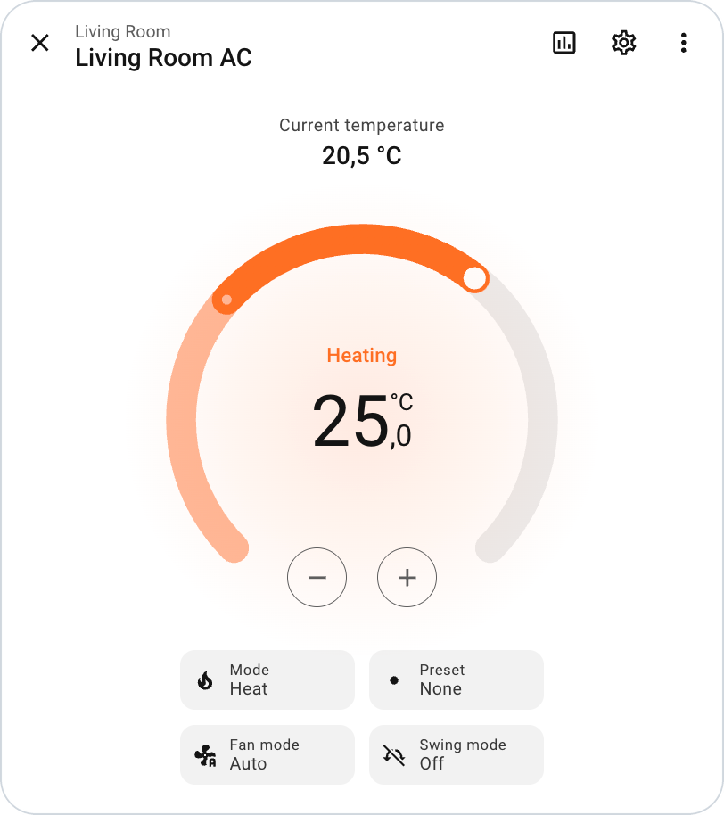
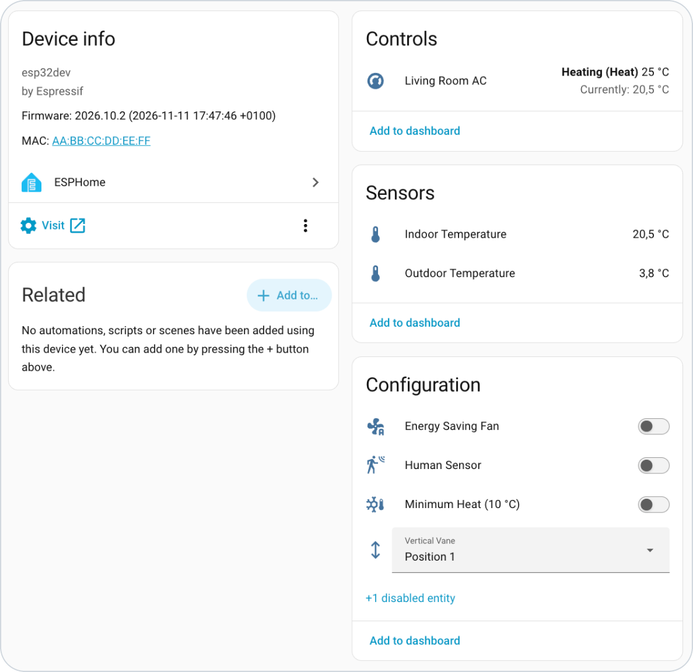

# ESPHome Fujitsu AC (UART) Component

[](https://github.com/martinhladil/esphome_fujitsu_ac/actions/workflows/ci.yml)

An [ESPHome](https://esphome.io) external component that controls Fujitsu air
conditioners over the indoor unit's UART port, the one the FGLair Wi-Fi dongles
(UTY-TFSXW1 and relatives) plug into. The unit shows up in Home Assistant as a
native `climate` entity with optional sensors, switches and selects. Everything
runs locally; the FGLair app and cloud are not involved.

This is an independent ESPHome reimplementation of the protocol
reverse-engineered by [Benas09/FujitsuAC](https://github.com/Benas09/FujitsuAC).
See [Credits](#credits).

<p align="center">
  
</p>

## Features

- **Climate entity:** power, mode (Auto / Cool / Dry / Fan / Heat), fan speed
  (Auto / Quiet / Low / Medium / High), target temperature in 0.5 °C steps,
  vertical and horizontal swing, current indoor temperature.
- **Presets:** ECO (Economy) and BOOST (Powerful).
- **Action:** the heating / cooling / drying / fan / idle / off state Home
  Assistant shows on the climate card. See [Limitations](#limitations) for how
  it is derived.
- **Sensors:** indoor and outdoor temperature.
- **Switches:** coil dry, outdoor low noise, minimum heat (10 °C), energy
  saving fan, human sensor.
- **Selects:** vertical and horizontal vane position.
- **Capability discovery:** the unit reports which features it has. Swing
  modes, presets and each vane's position list are narrowed to match.
- **Link recovery:** if the unit stops answering (for example after a power
  cut), the component flags a warning and redoes the handshake until it is back.

Everything beyond the climate entity is optional. With the sensors, switches
and a vane select configured, the device page in Home Assistant looks like this:

<p align="center">
  
</p>

## Compatibility

**Air conditioners.** Any indoor unit that accepts one of the dongles below
should work, since the component speaks the same protocol the dongle does.
The list comes from the upstream project:

| Dongle family | Models |
| --- | --- |
| UTY-TFSXW1 | UTY-TFSXW1 |
| Z series | UTY-TFSXZ1, UTY-TFSXZ2, UTY-TFSXZ4 |
| F series | UTY-TFSXF1, UTY-TFSXF2, UTY-TFSXF3 |
| H series | UTY-TFSXH3, UTY-TFSXH4 |

Not every model in the table has been confirmed. Upstream keeps a
[list of tested air conditioners](https://github.com/Benas09/FujitsuAC/discussions/24);
check it for your unit before buying parts.

**Controller.** An ESP32 is required, because the bus needs inverted UART
signals. The component is developed on an `esp32dev` board with the ESP-IDF
framework. Other ESP32 variants should work but are not tested, and neither is
the Arduino framework.

**ESPHome.** Tested on 2026.9 and 2026.10. CI compiles against the current
stable and beta releases every week.

**Other controllers keep working.** The IR remote and a wired wall controller
can be used alongside this component; changes made from either appear in Home
Assistant on the next poll.

## Wiring

> [!WARNING]
> The unit's data and GND pins are **not galvanically isolated** and are not
> referenced to earth. Never connect anything powered from the air conditioner
> to a computer at the same time: joining the two grounds can destroy the
> computer's USB port and the unit's mainboard fuse. Flash the ESP32 before
> plugging it into the unit, and update it over the air afterwards.

You need:

- an ESP32 board,
- a 12 V to 5 V DC/DC converter (the port supplies 12 V),
- a logic-level shifter for the two data lines,
- a plug for the unit's port.

Indoor units have one of two port styles. Pin 1 is leftmost on the JST socket
and topmost on the USB-style one.

| Pin | JST-style port | USB-style port |
| --- | --- | --- |
| 1 | +12 V | +12 V |
| 2 | GND | Data, unit → ESP32 (`rx_pin`) |
| 3 | Data, unit → ESP32 (`rx_pin`) | Data, ESP32 → unit (`tx_pin`) |
| 4 | Data, ESP32 → unit (`tx_pin`) | GND |

The link is 9600 baud, 8N1, and **both data lines are inverted**, so set
`inverted: true` on both pins. Without inversion the traffic looks like noise
and the handshake never completes.

For photos of the sockets, a parts list with links, and circuit diagrams, see
the [upstream build instructions](https://github.com/Benas09/FujitsuAC#building-the-module).
If you would rather not solder, the upstream author sells a
[ready-made dongle](https://www.faircon.lt).

## Configuration

```yaml
external_components:
  - source: github://martinhladil/esphome_fujitsu_ac
    components: [fujitsu_ac]

uart:
  id: ac_uart
  baud_rate: 9600
  tx_pin: { number: GPIO17, inverted: true }
  rx_pin: { number: GPIO16, inverted: true }

climate:
  - platform: fujitsu_ac
    id: living_room_ac
    name: "Living Room AC"
    uart_id: ac_uart
    outdoor_temperature: { name: "Outdoor Temperature" }
    indoor_temperature: { name: "Indoor Temperature" }

switch:
  - platform: fujitsu_ac
    fujitsu_ac_id: living_room_ac
    coil_dry: { name: "Coil Dry" }
    minimum_heat: { name: "Minimum Heat (10 °C)" }

select:
  - platform: fujitsu_ac
    fujitsu_ac_id: living_room_ac
    vertical_vane: { name: "Vertical Vane" }
```

[example.yaml](example.yaml) is a complete configuration with every entity.

Keep the `logger` off the UART pins used for the unit.

### `climate`

Accepts all standard [climate options](https://esphome.io/components/climate/),
plus:

| Option | Description |
| --- | --- |
| `uart_id` | The UART bus connected to the unit. Must be 9600 baud, 8N1; this is checked at compile time. |
| `indoor_temperature` | Optional [sensor](https://esphome.io/components/sensor/) for the indoor unit's room temperature reading. |
| `outdoor_temperature` | Optional sensor for the outdoor unit's temperature reading. |

### `switch`

Each key is optional and takes the standard
[switch options](https://esphome.io/components/switch/). An entity is created
only for the keys you list.

| Key | Function |
| --- | --- |
| `coil_dry` | Runs the fan after cooling to dry the indoor coil. |
| `outdoor_low_noise` | Limits outdoor unit noise. Not offered on multi-split systems, where several indoor units share one outdoor unit. |
| `minimum_heat` | Frost protection: holds the room at about 10 °C. |
| `energy_saving_fan` | In cooling, runs the indoor fan intermittently at very low speed while the outdoor unit is stopped. |
| `human_sensor` | Enables the unit's occupancy sensor. |

### `select`

| Key | Function |
| --- | --- |
| `vertical_vane` | Vertical louver position. |
| `horizontal_vane` | Horizontal louver position. |

The options are `Position 1` up to `Position 6` (trimmed to the number of
positions the unit reports), `Swing` if the axis supports it, and `Closed`.
`Closed` is what the unit reports while it is off; it cannot be selected.

### Which entities does my unit support?

At startup the component logs a capability summary: swing per axis, economy,
powerful, minimum heat, human sensor, energy saving fan, outdoor low noise,
coil dry, and the vane position counts. Check the ESPHome log after boot and
configure only what your unit reports. To keep an entity for automations but
hide it from dashboards, set `internal: true` on it.

## Troubleshooting

| Log message | Meaning and usual cause |
| --- | --- |
| `Handshake timeout, retrying until the unit answers` | The unit has never answered. Check that both pins have `inverted: true`, that TX and RX are not swapped, that the level shifter is powered, and that the logger is not using the same UART. |
| `Init1 response mismatch` / `Init2 response mismatch` | Something answered, but not with the expected reply. Usually a wiring or inversion problem on one line. |
| `No response from unit` | A single request went unanswered. Occasional occurrences are harmless; the request is retried on the next cycle. |
| `Link lost after 5 unanswered requests, restarting handshake` | The unit stopped answering, typically because it lost power. The component recovers by itself once the unit is back. |
| `Skipping write ... (coil-dry / minimum-heat active)` | A setting was changed while a special cycle was running. See [Limitations](#limitations). |

Set the logger level to `VERBOSE` to see individual frames.

## Limitations

- **The action is inferred.** The bus carries no compressor state, so the
  action is derived from the mode and the gap between indoor temperature and
  setpoint. In Cool and Heat it stays active until the room is 0.5 °C past the
  setpoint; in Auto it is idle within ±0.5 °C. Treat it as a display hint, not
  a measurement.
- **Setpoint range depends on the mode.** Heat accepts 16–30 °C; Cool, Dry and
  Auto accept 18–30 °C. A lower request is raised to 18 °C.
- **Coil dry and minimum heat lock other settings.** While either is running,
  changes to mode, fan speed, temperature and presets are not sent. Coil dry
  also blocks swing and vane changes.
- **Entities cannot disappear at runtime.** A switch or select you configure
  for a feature the unit lacks stays in Home Assistant; the unit ignores what
  it writes.
- **Some registers are not decoded.** A few `0x12xx` / `0x14xx` registers are
  exchanged by the original dongle but their meaning is unknown.

The bus protocol is documented in [docs/PROTOCOL.md](docs/PROTOCOL.md).

## Development

`example.yaml` pulls the component from GitHub, so compiling it does not build
your working tree. Point `external_components` at the checkout instead:

```yaml
external_components:
  - source: { type: local, path: components }
    components: [fujitsu_ac]
```

```sh
esphome compile example.yaml
```

Run the host-side protocol test (no hardware and no ESPHome needed):

```sh
c++ -std=c++17 -I components/fujitsu_ac tests/test_protocol.cpp -o /tmp/t && /tmp/t
```

CI runs both on every pull request.

## Credits

This component exists because of
[Benas09/FujitsuAC](https://github.com/Benas09/FujitsuAC) by Benas Ragauskas,
the original reverse-engineering of this bus. The framing, handshake, register
map and value encodings used here all come from that work and from the wider
community that captured and shared bus traces.

This repository is not affiliated with or maintained alongside the original
project. If you want a complete standalone firmware with MQTT autodiscovery,
one-click updates and a setup portal, use the original.

If this component is useful to you, please support the original author:

- Star the repository: https://github.com/Benas09/FujitsuAC
- Donate: https://donate.stripe.com/8x23cvdbXdht57Zfym1sQ05
- Buy a ready-made dongle: https://www.faircon.lt

## Disclaimer

This is an independent community project provided as-is, with no warranty. It
is not affiliated with or endorsed by Fujitsu General Limited. FGLair is a
registered trademark of Fujitsu General Limited. Working on mains-powered
equipment carries risk to the hardware and to you; proceed at your own risk.
